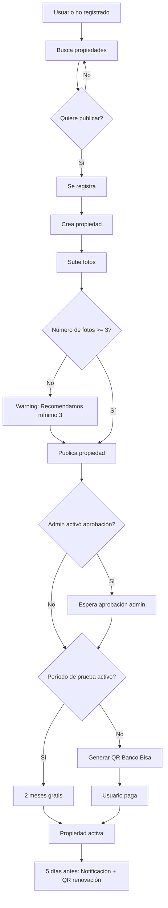
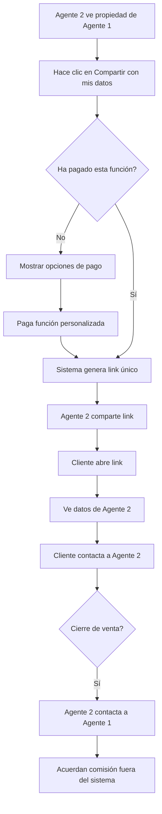

# 📋 Requerimientos Funcionales - SaaS Inmobiliario 365Soft

## 🎯 Visión General del Negocio

Sistema inmobiliario que permite a usuarios (personas naturales, agentes, inmobiliarias) publicar y buscar propiedades en Bolivia con un modelo de negocio SaaS basado en suscripciones.

---

## 🏢 Actores del Sistema

### 1. Usuario No Registrado (Visitante)
- Puede buscar y ver propiedades
- No puede publicar propiedades
- No tiene acceso a funcionalidades de usuario registrado

### 2. Usuario Registrado (Persona Natural)
- Se registra con email/contraseña o Google OAuth
- Puede buscar y ver propiedades
- Puede publicar sus propias propiedades
- Tiene acceso a CRM básico
- Puede ver sus publicaciones y renovarlas

### 3. Agente Inmobiliario
- Todo lo de Usuario Registrado
- Perfil optimizado para gestión de múltiples propiedades
- CRM para gestionar clientes
- Puede compartir propiedades con sus datos de contacto

### 4. Inmobiliaria
- Todo lo de Agente Inmobiliario
- Puede tener NIT y nombre comercial
- Gestión de propiedades bajo marca de inmobiliaria

### 5. Administrador del Sistema
- Gestión completa del sistema
- Configuración de parámetros
- Aprobación de propiedades (si está activado)
- Gestión de usuarios y pagos
- Acceso a estadísticas y reportes

---

## 📦 Módulos Funcionales

### 1. Módulo de Autenticación

#### 1.1 Registro de Usuario
**Descripción:** Permitir que nuevos usuarios se registren en el plataforma.

**Campos requeridos:**
- Nombre (obligatorio)
- Email (obligatorio, único)
- Contraseña (obligatorio, mínima seguridad)
- Teléfono (opcional, con prefijo de país +591)

**Campos opcionales:**
- Apellidos
- Avatar

**Funcionalidades:**
- ✅ Registro con email/contraseña
- ✅ Registro con Google OAuth
- ✅ Verificación de email (token enviado por email)
- ✅ Validación de email único
- ✅ Hash de contraseña (bcrypt)

**Rol por defecto:** Usuario normal (puede ser cambiado por admin)

#### 1.2 Login
**Descripción:** Autenticar usuarios existentes.

**Funcionalidades:**
- ✅ Login con email/contraseña
- ✅ Login con Google OAuth
- ✅ Generación de JWT token
- ✅ Refresh token (opcional)

#### 1.3 Gestión de Perfil
**Funcionalidades:**
- Ver perfil propio
- Actualizar datos personales
- Cambiar contraseña
- Subir avatar

---

### 2. Módulo de Propiedades

#### 2.1 Creación de Propiedad
**Descripción:** Usuario registrado puede crear una propiedad para publicar.

**Campos obligatorios:**
- Título (mínimo 10 caracteres, máximo 200)
- Descripción (mínimo 50 caracteres)
- Tipo de propiedad (casa, departamento, terreno, local, oficina, galpón, hacienda, lote)
- Tipo de operación (venta, alquiler, anticrético)
- Precio (mayor a 0)
- Moneda (USD, BOB)
- Ciudad (obligatorio)
- Dirección (opcional pero recomendado)

**Campos opcionales:**
- Zona
- Latitud/Longitud (para mapa)
- Metraje total
- Metraje construido
- Número de habitaciones
- Número de baños
- Número de garages
- Antigüedad (años)

**Amenities (boolean):**
- Piscina
- Jardín
- Terraza
- Servicio completo
- Seguridad
- Amueblado
- Acepta mascotas

**Fotos:**
- **Recomendado:** Mínimo 3 fotos
- **Máximo:** 7 fotos
- Formatos: JPEG, PNG, WEBP
- Tamaño máximo: 5MB por foto
- Una foto marcada como portada

**Validaciones:**
- Si carga menos de 3 fotos: **Warning** (advertencia, pero permite continuar)
- Si carga más de 7 fotos: **Error** (no permite continuar)

#### 2.2 Listado de Propiedades
**Descripción:** Buscar y filtrar propiedades.

**Para usuarios NO registrados:**
- Ver listado de propiedades activas
- Aplicar filtros de búsqueda
- Ver detalles de propiedad
- NO pueden ver datos de contacto del agente (deben registrarse)

**Para usuarios registrados:**
- Todo lo anterior
- Ver datos de contacto del agente
- Botón de WhatsApp directo
- Botón de llamar
- Compartir propiedad

**Filtros de búsqueda:**
- Tipo de propiedad (multi-selección)
- Tipo de operación (multi-selección: venta, alquiler, anticrético)
- Rango de precios (mínimo, máximo)
- Ciudad/Zona
- Metraje (mínimo, máximo)
- Habitaciones (mínimo, máximo)
- Baños (mínimo, máximo)
- Amenities (multi-selección)
- Ordenar por:
  - Precio ascendente/descendente
  - Más recientes
  - Más relevantes

**Paginación:**
- 20 propiedades por página
- Total de resultados
- Página actual

#### 2.3 Detalle de Propiedad
**Información mostrada:**
- Todas las datos de la propiedad
- Galería de fotos (hasta 7)
- Ubicación en mapa (si tiene lat/lng)
- Datos del contacto:
  - Nombre del agente/propietario
  - Teléfono
  - WhatsApp
  - Email (si está disponible)

**Para no registrados:**
- NO ven datos de contacto
- Call-to-action: "Regístrate para ver contacto"

**Métricas:**
- Contador de vistas
- Fecha de publicación

#### 2.4 Edición de Propiedad
**Descripción:** El dueño de la propiedad puede editarla.

**Restricciones:**
- Solo el usuario creador puede editar
- Si la propiedad está publicada y activa, los cambios pueden requerir reaprobación (configurable)

#### 2.5 Eliminación de Propiedad
**Descripción:** Soft delete de propiedades.

**Restricciones:**
- Solo el usuario creador puede eliminar
- Soft delete (no se borra físicamente de BD)
- Admin puede recuperar

---

### 3. Módulo de Publicaciones

#### 3.1 Flujo de Publicación
**Descripción:** Proceso para hacer pública una propiedad.

**Paso 1: Usuario crea propiedad**
- Llena todos los datos
- Sube fotos (recomendado 3-7)

**Paso 2: Usuario publica la propiedad**
- Sistema verifica que la propiedad esté completa
- Sistema calcula fecha de vigencia:

  **Opción A: Período de prueba GRATIS** (configurable por admin)
  - 2 meses GRATIS sin pagar
  - Después de 2 meses: Debe pagar para renovar

  **Opción B: Pago inmediato** (si admin desactivó prueba gratuita)
  - Usuario debe pagar desde el inicio

**Paso 3: Generación de QR (Banco Bisa)**
- Sistema genera QR de pago
- Usuario paga con QR

**Paso 4: Aprobación (configurable)**
- **Modo con aprobación:** Admin revisa y aprueba la propiedad
- **Modo sin aprobación:** Se publica automáticamente después del pago

**Paso 5: Publicación activa**
- Propiedad visible en búsquedas
- Cuenta regresiva de vigencia

#### 3.2 Vigencias y Renovación
**Vigencia estándar:**
- **1 año** de publicación (hasta que se venda)

**Recordatorios:**
- **5 días antes** de vencer: Sistema envía notificación
- Notificación incluye:
  - Aviso de vencimiento
  - QR para pagar renovación
- **1 día después** de vencer: Propiedad se desactiva automáticamente

**Renovación:**
- Usuario paga nuevamente
- Vigencia se extiende 1 año desde la fecha de renovación
- Se reinicia contador de renovaciones

#### 3.3 Estados de Publicación
- `borrador`: Propiedad creada pero no publicada
- `pendiente`: Esperando aprobación de admin (si está activo)
- `activa`: Publicada y visible
- `inactiva`: Vencida o pausada por dueño
- `rechazada`: Rechazada por admin

---

### 4. Módulo de Pagos (Banco Bisa)

#### 4.1 Generación de QR
**Descripción:** Sistema genera QR para pago de publicación.

**Flujo:**
1. Usuario solicita publicar
2. Sistema crea registro de `Payment` con estado `pendiente`
3. Sistema llama API de Banco Bisa
4. Banco Bisa retorna:
   - QR code (imagen)
   - URL del QR
   - Referencia de pago
   - Fecha de expiración
5. Sistema guarda en BD
6. Frontend muestra QR al usuario

#### 4.2 Verificación de Pago
**Dos mecanismos:**

**Opción A: Webhook (recomendado)**
- Banco Bisa envía POST a endpoint del sistema
- Sistema verifica firma de seguridad
- Sistema actualiza estado del pago
- Sistema activa publicación

**Opción B: Polling (fallback)**
- Worker verifica cada 10 minutos
- Llama API de Banco Bisa para consultar estado
- Actualiza si el pago fue completado

#### 4.3 Estados de Pago
- `pendiente`: Esperando pago
- `completado`: Pago exitoso
- `fallido`: Error en pago
- `expirado`: QR expiró sin pago
- `reembolsado`: Devolución (manual por admin)

---

### 5. Módulo CRM (Básico)

#### 5.1 Gestión de Clientes
**Descripción:** Cada usuario tiene SU propio CRM para gestionar leads.

**Crear cliente:**
- Manual: Usuario ingresa datos
- Automático: Cuando alguien contacta por una propiedad

**Datos del cliente:**
- Nombre (obligatorio)
- Email (opcional)
- Teléfono (opcional)
- WhatsApp (opcional)
- Estado (nuevo, contactado, interesado, negociación, cerrado, perdido)
- Origen (web, whatsapp, referencia)
- Mensaje inicial (opcional)
- Propiedad de interés (opcional)

#### 5.2 Interacciones con Clientes
**Registrar interacción:**
- Tipo: llamada, whatsapp, email, visita, nota
- Notas de la interacción
- Fecha y hora

**Historial:**
- Ver todas las interacciones con un cliente
- Ordenadas por fecha (más reciente primero)

#### 5.3 Dashboard CRM
**Métricas:**
- Total de clientes
- Nuevos clientes este mes
- Clientes por estado
- Próximos contactos programados
- Tasa de conversión

#### 5.4 Notas y Recordatorios
- Agregar notas a clientes
- Programar próximo contacto
- Notas visibles en el perfil del cliente

---

### 6. Módulo de Compartir Propiedades

#### 6.1 Compartir Estándar
**Descripción:** Cualquier usuario puede generar un link para compartir una propiedad.

**Link estándar:**
- URL: `https://plataforma.com/propiedades/{id}`
- Muestra datos del agente original

**Opciones de compartir:**
- WhatsApp
- Email
- Copiar link
- Facebook (opcional)

#### 6.2 Compartir Personalizado (Requiere Pago)
**Descripción:** Un agente puede generar un link personalizado con SUS datos de contacto.

**Flujo:**
1. Agente 2 ve propiedad de Agente 1
2. Agente 2 hace clic en "Compartir con mis datos"
3. Sistema verifica que Agente 2 haya pagado esta función
4. Sistema genera link único: `https://plataforma.com/propiedades/{id}?ref={agente2_id}`
5. Cuando alguien abre el link, ve datos de Agente 2
6. Si cierran venta: Agente 2 contacta a Agente 1 (fuera del sistema, comisión manual)

**Restricciones:**
- Solo disponible para agentes que han pagado
- El link personalizado expira según configuración
- Sistema registra cuántas veces se compartió

---

### 7. Módulo de Notificaciones

#### 7.1 Tipos de Notificaciones
**Renovación de publicación:**
- 5 días antes de vencer
- Incluye QR para pagar

**Publicación aprobada:**
- Cuando admin aprueba propiedad

**Publicación rechazada:**
- Cuando admin rechaza (con motivo)

**Nuevo cliente en CRM:**
- Cuando alguien interesado contacta

**Recordatorio de contacto:**
- Recordatorios programados en CRM

#### 7.2 Canales de Notificación
- **In-app:** Notificaciones dentro del sistema
- **Email:** Enviado a email del usuario
- **WhatsApp:** (Futuro, no en MVP)

---

### 8. Módulo Admin

#### 8.1 Gestión de Usuarios
**CRUD de usuarios:**
- Ver listado de usuarios
- Ver detalle de usuario
- Editar usuario
- Eliminar usuario (soft delete)
- Cambiar rol de usuario
- Activar/desactivar usuario

#### 8.2 Aprobación de Propiedades
**Si está activo el modo de aprobación:**
- Ver listado de propiedades pendientes
- Ver detalle de propiedad
- Aprobar propiedad
- Rechazar propiedad (con motivo obligatorio)

#### 8.3 Gestión de Pagos
**Ver pagos:**
- Listado de todos los pagos
- Filtrar por estado
- Ver detalle de pago
- Actualizar estado de pago (manual)

#### 8.4 Configuración del Sistema
**Parámetros configurables:**
- `activar_aprobacion_propiedades`: Boolean
  - `true`: Admin debe aprobar cada propiedad
  - `false`: Se publican automáticamente post-pago

- `periodo_prueba_gratis`: Boolean
  - `true`: Nuevos usuarios tienen 2 meses gratis
  - `false`: Deben pagar desde el inicio

- `meses_gratis`: Integer (default: 2)
  - Número de meses de prueba gratuita

- `vigencia_publicacion_meses`: Integer (default: 12)
  - Meses de vigencia de una publicación

- `dias_aviso_renovacion`: Integer (default: 5)
  - Días antes de vencer para enviar notificación

- `fotos_minimo_recomendado`: Integer (default: 3)
  - Mínimo de fotos recomendado (warning)

- `fotos_maximo_permitido`: Integer (default: 7)
  - Máximo de fotos permitido

#### 8.5 Estadísticas y Reportes
**Dashboard admin:**
- Total de usuarios registrados
- Total de propiedades publicadas
- Total de propiedades activas
- Ingresos del mes
- Pagos pendientes
- Propiedades por aprobar

**Reportes:**
- Usuarios nuevos por fecha
- Propiedades publicadas por fecha
- Ingresos por fecha
- Pagos por estado

---

## 🔄 Flujos de Negocio Importantes

### Flujo 1: Primer vez publicando (con prueba gratuita)

### Flujo 2: Agente compartiendo propiedad personalizada

---

## 📊 Requerimientos de Datos

### Datos Mínimos de Propiedad
Para publicar, estos campos son obligatorios:
- Título
- Descripción
- Tipo de propiedad
- Tipo de operación
- Precio
- Ciudad

### Datos Recomendados
- Ubicación exacta (dirección, lat/lng)
- Características (habitaciones, baños, garages)
- Metraje
- Amenities
- Mínimo 3 fotos

---

## 🎨 Requerimientos de UI/UX

### Búsqueda
- Filtros visuales e intuitivos
- Multi-selección en tipos y operaciones
- Autocomplete para ciudades
- Ordenar por relevancia

### Detalle de Propiedad
- Galería de fotos atractiva
- Mapa integrado
- Datos de contacto claros
- Botones de acción prominentes

### Mobile-First
- Todo responsive
- Optimizado para celulares
- Botones grandes para tocar
- Carga rápida

---

## ✅ Criterios de Aceptación

### Módulo de Propiedades
- [ ] Usuario puede crear propiedad con todos los campos
- [ ] Sistema valida campos obligatorios
- [ ] Sistema avisa si carga menos de 3 fotos (no bloquea)
- [ ] Sistema bloquea si carga más de 7 fotos
- [ ] Usuario puede subir máximo 7 fotos
- [ ] Sistema redimensiona fotos automáticamente
- [ ] Usuario puede marcar foto como portada
- [ ] Usuario puede reordenar fotos

### Módulo de Publicaciones
- [ ] Usuario puede publicar propiedad
- [ ] Sistema genera QR de pago correctamente
- [ ] Sistema activa publicación post-pago
- [ ] Sistema envía notificación 5 días antes de vencer
- [ ] Sistema desactiva publicación después de vencer
- [ ] Usuario puede renovar publicación pagando

### Módulo CRM
- [ ] Usuario puede crear cliente manualmente
- [ ] Sistema crea cliente automáticamente cuando contactan
- [ ] Usuario puede registrar interacciones
- [ ] Usuario ve historial de interacciones
- [ ] Dashboard muestra métricas correctas

---

**Última actualización:** 2026-04-09
**Versión:** 1.0.0
**Autor:** Scrum Master 365Soft
